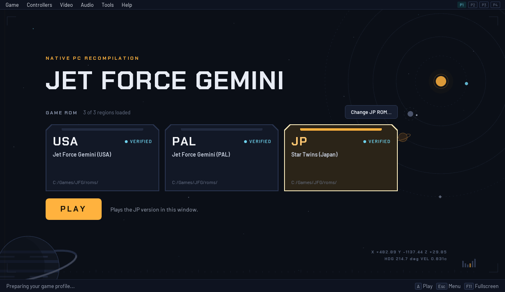
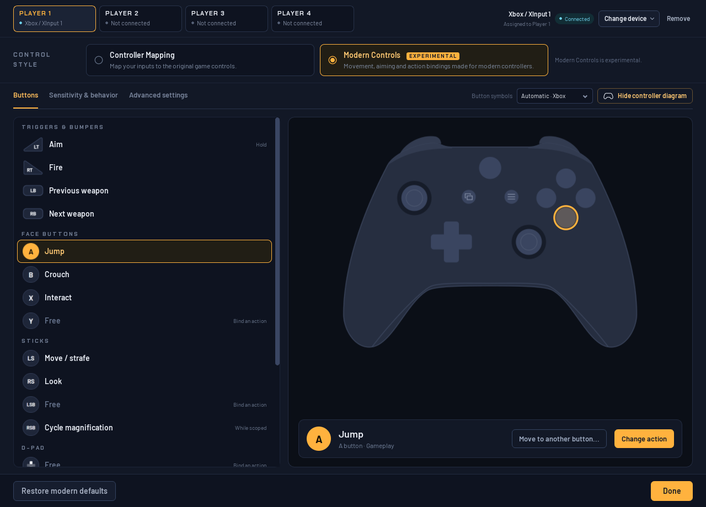
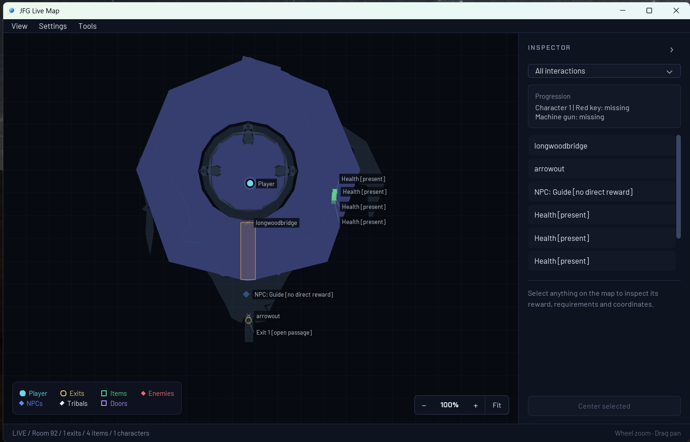

# Jet Force Gemini Recomp

A native PC recompilation of Jet Force Gemini for Windows x64. **Version 1.5.0 supports all three
original ROM versions: USA, PAL (Europe), and Japan (Star Twins), including the original in-game
language options provided by each ROM.** Import your ROM, select its cartridge in the launcher,
and click **Play**. The selected ROM is remembered between sessions.

Prebuilt packages require no developer tools or first-run compilation. The currently published
v1.4.0 package supports the US ROM; use a 1.5.0 build for PAL and Japanese support.
See [1.5.0 qualification and publication status](docs/releases/qualification-1.5.0.md).

[Get started](docs/getting-started.md) | [Documentation](docs/README.md) | [Project status](docs/status.md) |
[Changelog](CHANGELOG.md) | [Known issues](docs/known-issues.md) | [Report a problem](docs/playtesting.md)

Written with the help of **AI: Codex GPT 6 Astra**, with human direction, review and playtesting.

## Install and play

1. Download the **Windows x64 ZIP** from the [latest stable release](https://github.com/TK22-26/JetForceGemini-Recomp/releases/latest).
2. Extract the entire ZIP and open `JFG-Launcher.exe`.
3. In a 1.5.0 build, import your supported USA, PAL or Japanese ROM, select its cartridge, then click **Play**. The older v1.4.0 package accepts the US ROM only.

The launcher verifies the ROM and keeps a private local copy; the original file is no longer needed
after import. Existing profile saves remain available. Keep the imported copy: it supplies game assets.
See [requirements, updates and portable storage](docs/getting-started.md).

The installation approach is inspired by the **Zelda64Recomp team** and its
[plug-and-play distribution model](https://github.com/Zelda64Recomp/Zelda64Recomp#plug-and-play).
This is an independent implementation, with no endorsement or affiliation implied.

**We do not ship ROMs or game assets.** The bundle contains the compiled game program and host
libraries. Textures, models, audio and other game data come from your locally imported ROM and are
never uploaded. Original game content remains the property of its respective owners.

## Features

| Feature | Details |
|---|---|
| ROM regions and languages | USA, PAL (Europe) and Japan (Star Twins), with the original language options in each ROM; import multiple regions and choose which to play |
| Playable campaign | Start-to-finish campaign run, original local multiplayer and optional content; native rendering, audio, saving and loading |
| Modern controls | Optional mouse/keyboard and dual-stick controls for P1-P4, action bindings, separate camera/aim/scope tuning, original mapping alongside |
| Cutscene skipping | During supported cinematics press A, B or Start to show the prompt, then hold A for one second; unsupported scripts retain playback |
| Video options | Original/Custom/Unlimited presentation, VSync, adjustable blur and live fog strength; FPS changes take effect next game launch |
| Live map and inventory | Optional companion windows with room geometry, objects, progression and locally extracted inventory artwork |
| Optional Mods actions | Exit warps, health/enemy settings, weapon grants and Floyd unlock, with native eligibility and acknowledgement where applicable |
| Launcher services | Settings, portable storage, local support ZIPs and optional stable-release update checks |

v1.5.0 adds shared regional ROM support, cartridge selection, persistent region choice, graphics API
selection and the reviewed controls, camera, rendering and Proton corrections.
See the [1.5.0 source qualification](docs/releases/qualification-1.5.0.md) for validation and publication status.
Changes on `develop` can be unreleased candidates; their individual verification status is recorded in
[known issues](docs/known-issues.md).

## Controls and optional tools

Open **Controllers**, choose P1-P4, assign a device and select **Modern Controls** or original
**Controller Mapping**. Modern mouse defaults use WASD, right-click Aim, left-click Fire and the
wheel for weapon selection. Controller defaults use the left stick for movement and right stick
for look. Bindings and camera settings are saved per player.

Read the [controls guide](docs/features/pc-controls.md) for rolling, Floyd, menu navigation,
compatibility and unreleased additions. Some native menu pages still need directional input;
SDL/DualSense rumble, gyro and adaptive triggers remain future work.

[Live map and navigation](docs/features/navigation-mod.md) and the [launcher guide](docs/development/launcher.md)
explain optional tools and gameplay modifications. Save normally to retain inventory grants.
Game artwork used by the inventory is extracted locally from each player's verified ROM.

## Verification and original-game findings

The retained campaign verification used optional infinite-health/enemy auto-kill testing mods and
an all-Tribals testing save. Original-console accuracy, broader hardware/controller coverage and
specific bugs remain under validation. Automated tests and a successful build do not prove every
encounter or platform correct.

The [original N64 catalog](docs/original-game/README.md) records physical-hardware bugs separately
from emulator observations and regional differences. Published v1.4.0 packages support the pinned
US ROM. Version 1.5.0 supports the exact USA, PAL and Japanese revisions through one shared architecture;
[regional qualification](docs/development/issues/regional-rom-support.md) records the verified
builds, remaining gameplay checks and release status.

## Develop

Use [ROM-free setup and tests](docs/development/setup.md) or [build the playable game from your ROM](docs/development/rom-bootstrap.md).
The [repository layout](docs/development/repository-layout.md) explains source ownership and the
remove-by-default retention policy. [Contributing](CONTRIBUTING.md), [persistent issue records](docs/development/issues/README.md)
and [AGENTS.md](AGENTS.md) define review and guarded automation practices.

For a configured installation, `JFG-Launcher.exe --play` launches directly into the normal game flow.
See [command-line launch](docs/development/launcher.md#command-line-launch) for explicit profiles and the
standalone runtime. It does not choose an in-game save slot or warp to a level.

[Credits](CREDITS.md) | [Third-party notices](THIRD_PARTY_NOTICES.md) | [License](LICENSE) | [Security](SECURITY.md)
