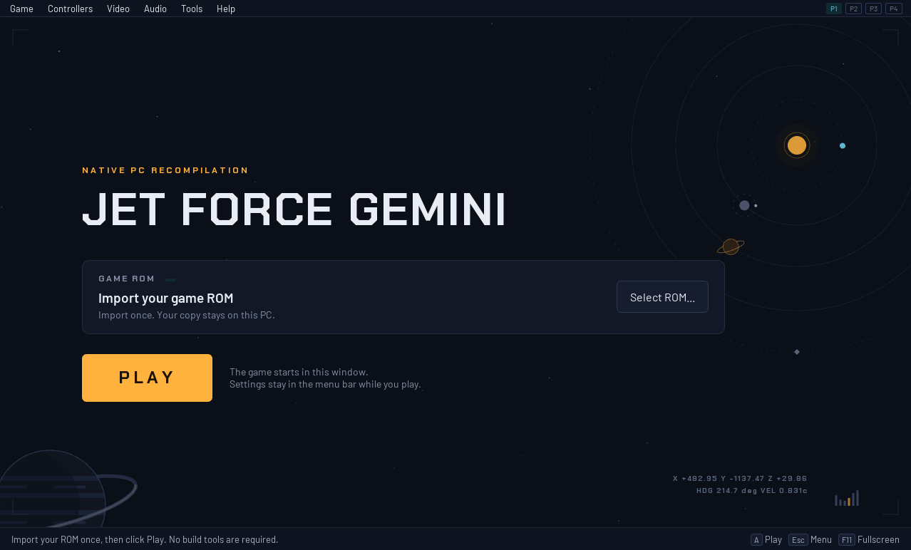
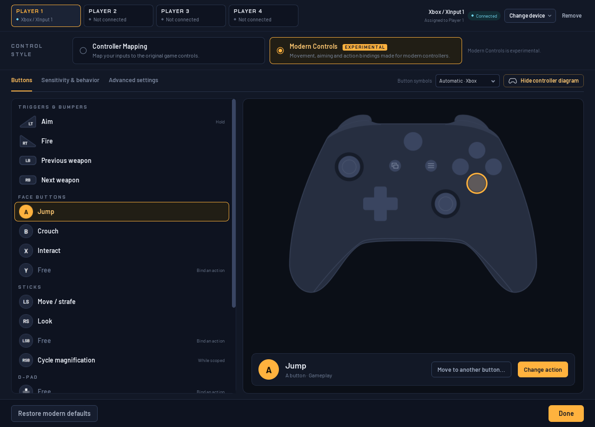
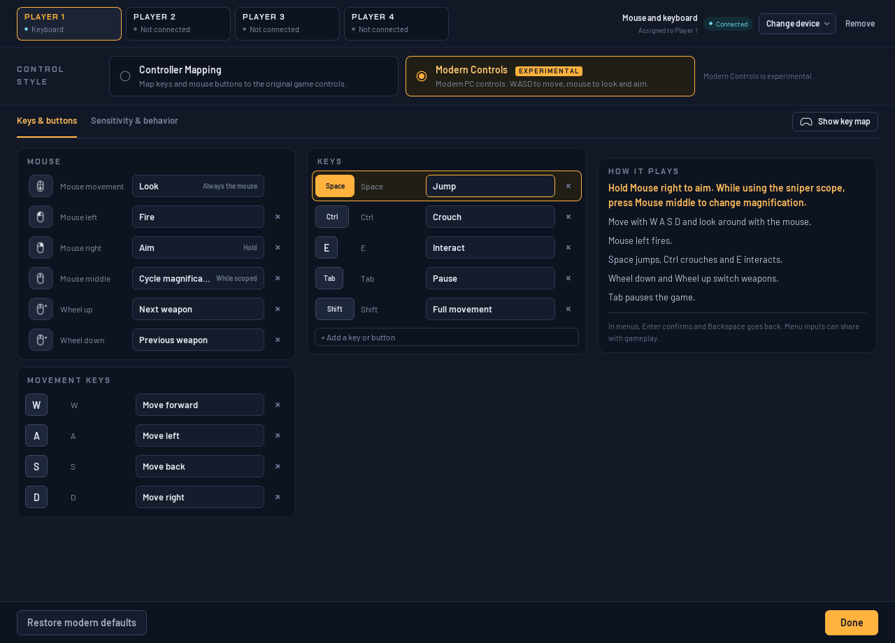
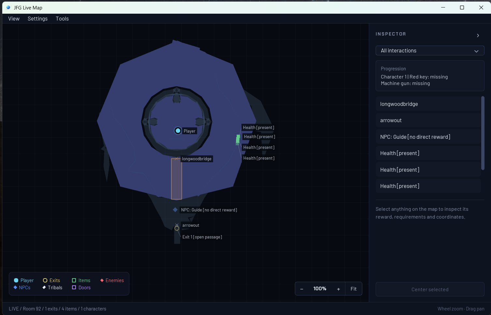

# Jet Force Gemini Recomp

A native PC recompilation of Jet Force Gemini for Windows x64.
**v1.4.0 is in final review on develop.** The candidate includes a prebuilt game: extract the ZIP, import your supported
North American ROM once, and click **Play**. No developer tools or compilation
are required.

**A complete, fully playable v1 release:** play the campaign from start to finish.
Original local multiplayer and optional content also work. The latest published
stable release is v1.3.0; v1.4.0 awaits the maintainer's final SS Anubis pass before
a main merge and publication. See the playtesting notes below
for the recorded campaign run and [known issues](docs/known-issues.md) for ongoing fixes.

Written with the help of **AI: Codex GPT 6 Astra**, with human direction,
review, and playtesting.

[Get started](docs/getting-started.md) · [Project dashboard](docs/dashboard.md) · [Changelog](CHANGELOG.md) ·
[Known issues](docs/known-issues.md) · [Report a problem](docs/playtesting.md) ·
[Contribute](CONTRIBUTING.md)

## Installation

Download the **Windows x64 ZIP** from the
[latest stable release](https://github.com/TK22-26/JetForceGemini-Recomp/releases/latest),
extract the entire ZIP, and open `JFG-Launcher.exe`. Use **Select ROM…** to import
your supported US `.z64` ROM. Once import finishes, the original file can be
moved or deleted; the launcher uses its private local copy. Existing saves
stay in your game profile. **Game > Select ROM…** remains available afterward.

*The startup screen before ROM import. Select your ROM once, then click Play;
the ROM card disappears after a successful import.*

The installation approach is inspired by the **Zelda64Recomp team** and
[Zelda64Recomp's plug-and-play distribution model](https://github.com/Zelda64Recomp/Zelda64Recomp#plug-and-play).
Credit to that project for this setup experience; this is an independent
implementation, with no endorsement or affiliation implied.

**We do not ship game assets or ROMs.** The release includes the compiled game
program and runtime libraries. Textures, models, audio, and other game data are
read from your locally imported ROM, which is never uploaded. Original game
content remains the property of its respective owners.

The v1.4.0 candidate adds native cutscene skipping, Modern controls for all four
players, Floyd flight controls, and fixes for camera resets, boss aiming, rain,
weapon reticles and paused inventory grants. It also improves Quarry's day/night
fog transitions, cinematic camera cuts and helper visibility, and launcher feedback. Adjustable motion blur, live fog strength
and portable storage remain available. See the [changelog](CHANGELOG.md) and
[final-review record](docs/development/releases-1.4.0-qualification.md).

For a portable installation, open **Game > Settings > Change directory** and
choose a folder inside the game folder. The launcher copies existing saves,
settings and imported ROM data, preserving files already at the destination,
then restarts. Move the complete game folder, including your selected data
folder and storage-location.txt, to keep that installation self-contained.

## What works

- **The entire campaign**, original local multiplayer, and optional content.
- Native rendering and audio, with saving and loading.
- A ready-to-play Windows x64 bundle with one-time ROM import.
- Configurable controllers, keyboard and mouse, and four original controller ports.
- Optional live map and live inventory tracking in a custom companion interface.
- A unified launcher with settings available while you play.

## A major quality-of-life upgrade: modern dual-stick and mouse controls

The controller and keyboard/mouse overhaul brings a much more comfortable PC
play experience. **Modern Controls** adds action-based bindings, mouse look and
dual-stick control, so movement, camera, aiming and weapons can be set up around
the way you play.

- **Mouse and keyboard aiming is supported:** move the mouse to look around and
  aim, **hold right-click to aim, and left-click to shoot** with the default
  bindings. WASD handles movement and strafing; the mouse wheel switches weapons.
  Keys, five mouse buttons and both wheel directions can be rebound.
- **Modern dual-stick controls are supported:** move and strafe with the left
  stick; look around and aim with the right stick.
  Xbox/XInput and compatible SDL gamepads have device-aware layouts, including
  Xbox and PlayStation button symbols.
- **Aim your way:** separate camera, aiming and sniper-scope sensitivity, X/Y
  inversion, controller deadzones and response curves. Move and strafe while
  aiming, and bind sniper magnification separately.
- **A visual controls editor:** see your bindings on controller diagrams or a
  keyboard/mouse layout; select an input, assign an action, and keep settings
  in your profile. Reconnecting a device preserves its saved bindings.
- **Mouse menu navigation:** point and click on supported title, save-selection
  and main pause-menu targets. Keyboard/controller navigation covers the other pages.
- **Keep the original feel when you want it:** switch back to **Controller Mapping**
  with Normal/Expert presets. Both layouts retain their bindings.

Open **Controllers**, choose P1-P4, assign a device, and select **Modern Controls**.
Each player keeps independent bindings and camera settings; Original mapping
remains available for every port. XInput rumble is available; native SDL/DualSense rumble, gyro and
adaptive triggers remain future work.

**v1.4.0 controls:** native boss aiming limits, crouch/prone side rolls, optional
Roll Left/Right bindings, and camera retention through ledges, landings, swimming
and focus changes. Modern gameplay remains experimental while camera, pointer
coverage and physical-device feel are refined.
See the [controls guide and validation notes](docs/features/pc-controls.md).

*Xbox controller diagram: select a button to see its action and change its binding.*

*Keyboard and mouse: the Keys & buttons view keeps mouse, movement and action bindings together.*

### Floyd

Modern controls now route Floyd's fire and flight inputs correctly. In missions,
mouse movement steers; **W** supplies thrust, **S** brakes, and **A/D** strafe with
default bindings. Left-click fires. For controllers, **Advanced > Invert Floyd
flight steering** defaults to the original aircraft direction and is independent
of normal look inversion. Co-op Floyd joins through the assigned player's Start
or Pause action. Native mission entry requirements, including Mizar tokens, apply.

## Cutscene skipping

During a supported cinematic, press **A, B or Start** to reveal the in-game prompt,
then **hold A for one second** to skip. The native blue-A prompt fills a white
progress ring; releasing early cancels the hold. Modern bindings use the actions
mapped to those native buttons.

Reviewed sequences complete their required progression and transitions.
Unsupported or context-dependent scripts retain normal playback. The private
scene selector is a development review tool and is not part of the release.

## High-refresh rendering

Open **Video > Video settings** for VSync, a Custom FPS target or Unlimited.
Rendering interpolates between game updates without speeding up gameplay.
The Rendering tab includes **Off / Reduced / Original** motion blur (Reduced
by default). Enhancements includes **0–100% fog strength**, which applies live. Frame-rate changes
apply the next time the game starts.
High-refresh presentation and Modern Controls remain opt-in; see
[qualification and limits](docs/known-issues.md).

## Launcher update notifications

The current launcher source checks for a newer stable release in the background
at startup and shows **Update available** on the home screen. Use
**Help > Check for updates…** whenever you want to check manually. The result
shows your installed version and the latest stable release, with a button to
open its download page. Offline checks never prevent playing.

The checker reads public GitHub release metadata without sending
your ROM, saves or settings. Downloads and installation remain your choice.

## Playtesting notes

The campaign verification run used optional infinite-health and enemy
auto-kill testing mods, plus a testing save with all Tribals unlocked.
Original-console accuracy remains under validation, and playtesting continues
across more PCs, controllers, and gameplay. See the
[runtime fix log](docs/development/boot-gameplay-fix.md) and
[project status](docs/status.md) for details.

## Live map and inventory

Optional companion tools provide a custom interface for exploring the game
and tracking your progress:

- **Live map:** see your position, room exits, items, NPCs, enemies, Tribals,
  and doors. Select an object to inspect its requirements and rewards; zoom,
  pan, or fit the map to the current room.
- **Live inventory:** track weapons, keys, quest items, and shared ship parts.
  View Juno, Vela, or Lupus, or follow the active character automatically.

*Live map in the custom companion interface.*

The inventory's game icons are extracted locally from each player's own ROM;
those artwork files are not bundled with the project or launcher. The interface
is custom project code. Game content remains the property of its respective
owners.

Open **Live map > Settings > Mods** for exit warps, infinite health, instant
enemy defeats, **Give weapons**, and **Unlock Floyd**. Weapon grants apply while
the Mods window is open and show **Given** only after runtime confirmation.
They affect the current character and refill ammunition once. Unlocking Floyd
takes effect on entering another room. Save normally to retain inventory/unlocks.

See the [launcher and live tools guide](docs/development/launcher.md) for details.

## Getting started

Start with the [getting started guide](docs/getting-started.md) for requirements,
downloads, and setup. You need a supported US big-endian `.z64` ROM;
the project does not provide ROMs or game assets.

The [released bundle](https://github.com/TK22-26/JetForceGemini-Recomp/releases)
is ready to play after ROM import. Developers can still build from source;
the guide explains both paths. Older v1.0 setup issues are documented in
[known issues](docs/known-issues.md#windows-10-setup).

## Help by playtesting

Play normally and report problems: crashes, freezes, progression blockers,
incorrect controls, graphics or audio, and save/load failures. Check
[known issues](docs/known-issues.md) first and attach the launcher's support
ZIP when available. Successful sessions do not need a report.

See [playtesting and reporting](docs/playtesting.md). If you want to contribute
code, [CONTRIBUTING.md](CONTRIBUTING.md) explains the pull request workflow.

Thank you to everyone sharing bug reports, requests and playtest results. Your
feedback and testing have made this project better. See [community credits](CREDITS.md).

## Compatibility still under review

Steam Deck/Proton startup has a Windows-tested launcher fallback, but no Steam
Deck result is available yet. Intermittent mouse input (#32), accumulating audio
delay (#35), and reporter-specific Ally X performance still need affected-user
evidence or retesting. These are not claimed as resolved by v1.4.0.
See [known issues](docs/known-issues.md).

## Future additions

The complete v1 game is here. Future work focuses on additional PC enhancements:

- **Ultrawide support:** wider aspect ratios with correct gameplay presentation,
  menus, and HUD layout.
- **Broader high-refresh qualification:** refine pacing and interpolation across
  additional scenes, hardware and output rates.
- **Mod support:** documented interfaces and tools for community modifications.
- **Controller extras:** native SDL/DualSense rumble, gyro aiming and adaptive triggers.
- **Further polish:** performance fixes, camera refinement, remaining mouse-menu
  targets, and better crash and freeze diagnostics.

Compatibility and stability come first. These are development goals; release
dates have not been set.

## Build and development status

- [Build status and CI runs](https://github.com/TK22-26/JetForceGemini-Recomp/actions/workflows/ci.yml)
- [Project status](docs/status.md)
- [Build the playable game from your ROM](docs/development/rom-bootstrap.md)
- [Build and test the project source](docs/development/setup.md)
- [Documentation index](docs/README.md) and [project roadmap](docs/planning/JFG_RECOMP_MASTER_PLAN.md)

CI checks source, tools, and tests without a ROM. A passing build does not
establish that every level or gameplay feature works.

## License

Original project code and documentation use the [MIT License](LICENSE).
Dependencies retain their [third-party notices](THIRD_PARTY_NOTICES.md).
Jet Force Gemini game content and trademarks belong to their respective owners.
