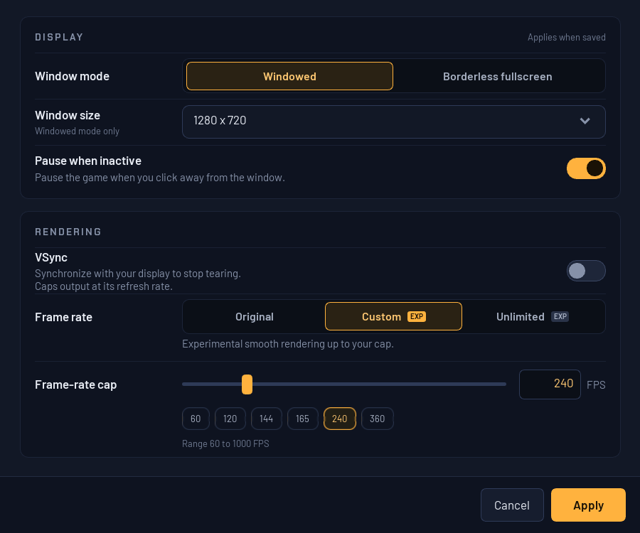

# Experimental high-refresh rendering

The research branch provides an RmlUi Video Settings window and opt-in
presentation interpolation while preserving the original guest clock. Custom
targets and uncapped rendering exceed 360 presentations/s in a short replay
fixture. This remains an unreleased candidate; sustained performance, broad scene
coverage and owner playtesting are pending.

## Try it

Open **Video > Video settings...** in the launcher. This is an owned Windows
window rendered with RmlUi, using the supplied dark-panel design, keyboard
navigation and Apply / OK / Cancel. It shares the launcher's embedded fonts and
rendering backend. It opens centered over the launcher at the owner's DPI,
with its position limited to the monitor work area so it stays on screen.



| Setting | Behavior |
|---|---|
| Original | Original presentation; default for profiles without video settings |
| Custom | Set 60-1000 FPS with the slider or exact whole-number field; presets 60, 120, 144, 165, 240 and 360 |
| Unlimited | Removes the FPS cap when VSync is off; no hidden numeric target |
| VSync | On synchronizes to the display; Custom is limited to detected refresh, and Unlimited follows refresh |
| Window mode / size | Windowed or borderless fullscreen; current size, 1280 x 720, 1600 x 900, 1920 x 1080 or 2560 x 1440 |
| Pause when inactive | Pause when the launcher loses focus |

Apply saves without closing; OK saves and closes; Cancel discards edits since
the last Apply. **Rendering changes apply on the next game launch.** Window and
pause preferences apply immediately when saved. This means stopping and starting
the game, not restarting Windows or the launcher. The restart chip is hidden when
no game is running. The original game controls aspect ratio; Borderless fullscreen
is the supported fullscreen mode.
Opening this dialog during gameplay requests the existing cooperative pause;
closing it releases that request. VSync off permits tearing. A Custom FPS value
is a target/cap, not a guarantee that every scene can reach it.

The profile's `video.ini` stores `version=1`, `mode=original|custom|unlimited`,
`fps=60..1000` and `vsync=0|1`, one key per line. The custom number is remembered
when switching modes. Missing configuration defaults to Original, 60, VSync on;
malformed or unreadable configuration is reported. Navigation-mod launches share
the main profile's video choices.

The machine-local complete preview is
`C:\JFG-builds\high-refresh-rml-video-preview-20261011`. Its
`Play-Video-Settings.cmd` and desktop **JFG - High Refresh Preview** shortcut reuse
the earlier isolated high-refresh preview profile, preserving its saves and video
preferences (initially Custom 60 / VSync on). Close the currently running launcher first: the production launcher
allows one instance per Windows session. Progress in the copied preview profile
stays there. This preview is not an installed update or a published release.

For standalone diagnostics, the [preview helper](../../scripts/play_high_refresh.ps1)
copies saves and selected configuration into a new directory per invocation:

```powershell
.\scripts\play_high_refresh.ps1 -Runtime C:\JFG-build\Release\jfg-native-boot.exe -Rom C:\Games\jfg.z64 -Save C:\Games\jfg.flash -Fps 360 -VSync Off
.\scripts\play_high_refresh.ps1 -Runtime C:\JFG-build\Release\jfg-native-boot.exe -Rom C:\Games\jfg.z64 -Save C:\Games\jfg.flash -Unlimited -VSync Off
```

`-Fps 0` means Original. Use `-ProfileDirectory` for controller, modern-control,
PC-input, audio and video files; `-ControllerPak` optionally copies a pak. Each
invocation starts from the supplied save; the helper prints the new save folder.
Advanced overrides are `JFG_VIDEO_CONFIG=<path>`,
`JFG_EXPERIMENTAL_RENDER_FPS=0|60..1000|unlimited`, and `JFG_RENDER_VSYNC=0|1`.
Normal launcher sessions sanitize inherited diagnostics and forward the profile.

## What was implemented

- Graphics tasks carry immutable guest VI timestamps and previous transform
  snapshots. Unique, unchanged mesh geometry identifies conservative matches.
- Presentation interpolates combined matrices; authored matrices and RT64's
  native-resolution feedback remain unchanged. Count, VI, audio and input
  simulation clocks are not accelerated.
- Shadow-only submissions retain scene history. Ambiguous geometry, irregular
  cadence, camera-plane crossings and large projected motion use endpoints.
- Custom uses a paced target. Unlimited with VSync off samples monotonic time
  within each source-frame window and reuses two synchronized render targets.
  A later VI repeats the latest completed image once, never overwritten history.
- Queued scenes or unknown work preempt Unlimited interpolation; shadow-only
  work waits at most the remaining source-frame window. This scheduling still
  needs broader wall-time and audio-device qualification.

The [DK64 and other port comparison](../upstream/high-refresh-reference-review-2026-10-11.md)
informed the design. No upstream game patches were imported. Dependency patches
apply only to exact hash-checked RT64 build-tree copies; the pinned source stays
unchanged. Original mode remains available.

## RmlUi window and restart verification (2026-10-11)

Implementation commit: `5527611ea10b247dbb2df46ca1870a8d93d365f4`.

The owner's `Child · Video settings-html.zip` design was translated into RML,
RCSS and native C++ events in the existing pinned RmlUi backend. No dependency
upgrade, browser, React runtime or remote font loading is needed. The previous
standard-controls dialog remains a fallback for builds without RmlUi.

The new window passes 101 checks, including real pointer/slider/text input,
presets, invalid values, Apply/Cancel/reopen, failed saves, window-size keyboard
selection, Escape closing the dropdown before the dialog and Tab navigation.
Screenshots were inspected at 100% and 150% layout scaling. The real launcher
fixture at 125% DPI verifies the menu route, owned modal, file persistence,
immediate fullscreen/windowed changes, pause preference and recovery after a
settings-process failure. Live gameplay verifies pause acknowledgment and a
stopped/resumed VI clock. Existing modern-controls (546) and controller-mapping
(207) checks pass. No physical desktop input or owner-window manipulation is used.

Restart behavior was tested against the unchanged renderer binary in three
900-VI runs. Saving VSync off during a 360-target session left its effective target
at the display's 240 Hz; the next game session used 360. Saving 144 during that
session left its target at 360; the next session used 144. Consequently, FPS and
VSync require a new game session. Display settings are applied directly by the
launcher and were verified without restarting the game.

Private evidence and failed attempts are indexed in
[RENDER-001](../development/issues/high-refresh-rendering.md). These tests qualify
the settings window and restart behavior; the rendering limits below still apply.

## Earlier native-controls candidate verification (2026-10-11)

Implementation commit: `b39533a5b3661544d5322bd70cd64ae9843f5254` on
`research/high-refresh-20261011`.

Hardware: RTX 5090, Ryzen 7 5800X, detected 240 Hz display, 640 by 480 output.
Measurements cover only the approximately 1.6-1.74-second moving-camera window
at VI 4000-4098 in isolated 4,100-VI replays. Capture readback runs are separate.

| Mode / VSync | Presents/s | Median / p95 / p99 interval (ms) | Evidence series |
|---|---:|---|---|
| Custom 60 / On | 59.99 | 16.658 / 16.970 / 17.126 | v1; fixed-rate path |
| Custom 360 / Off | 356.74 | 2.780 / 2.983 / 3.538 | v2 |
| Custom 1000 / Off | 644.78 | 1.007 / 3.753 / 11.494 | v3 |
| Unlimited / Off | 1137.31 | 0.575 / 2.503 / 6.788 | v3 |

These are short-scene presentation rates, not sustained whole-game benchmarks
or physical 360 Hz display qualification. The v3 Unlimited replay took 71.515 s
versus Original's 70.109 s (about 2% longer); equal guest execution does not imply
identical wall-time throughput. Unlimited pacing remains uneven. Initial v1
Unlimited throughput was invalidated by completed-ring replay and is excluded.

Compared modes preserve byte-identical 4 MiB guest RAM, 8 MiB renderer snapshots,
recorded input, saves and the entire probe result. All report 1,906 controller
samples, 2,896 graphics tasks, 2,047 decoded audio tasks, 3,680,667,236 instructions
and zero unsupported accesses. This proves fixture equivalence, not audio-device
underrun behavior or full resumable snapshot equivalence.

The final runtime's separate swapchain capture has two sampled groups of four
distinct images, including indices beyond the two-slot ring. Its memory, input,
save and probe still match Original. Sampled HUD, character and reflection are
visible. Seven focused C++ tests, 637 managed launcher checks, 15 setup checks,
six graphics checks and viewport checks passed. Native-control tests cover
validation, slider/edit synchronization, persistence, Apply, Cancel and reopen.
The real frontend and a replay-driven game on an inactive desktop verify the
Video menu route, owned modal, runtime pause acknowledgment, stopped/resumed VI
clock and unchanged source save. Only the fixture launcher singleton differs;
that test executable is not delivered.

See [RENDER-001](../development/issues/high-refresh-rendering.md) for source and
binary receipts, failed attempts and private evidence. The probe deliberately
retains `acceptance=false` and `runtime_snapshot_complete=false`.

## Historical first candidate (before native controls)

Implementation source: local commit `8d8f09701cc50d3a5b03eafd90ff5a41d3aeb3e9`.

Hardware: RTX 5090, Ryzen 7 5800X, RT64-detected 240 Hz display; captured output
640 by 480. Three identical-input replays ended at VI 4100 in 70.16-70.33 seconds.
The original, 60-target and 360-target runs have byte-identical 4 MiB guest RAM,
8 MiB renderer snapshots, recorded input and saves, plus the same probe state hash.
Instruction, controller-sample, graphics-task and decoded-audio-task counts also
agree. This does not establish audio-device underrun behavior or full resumable
snapshot equivalence.

| Requested FPS | Effective target | Camera-window presents/s | Median / p95 / p99 interval (ms) |
|---:|---:|---:|---|
| 60 | 60 | 59.98 | 16.672 / 16.738 / 16.755 |
| 360 | 240 | 239.81 | 4.170 / 4.303 / 4.411 |

Rates and interval percentiles cover the approximately 1.6-second moving-camera
window at VI 4000-4098, excluding screenshot readback. That window rendered two
or eight presentation states per authored 30 Hz scene. The full replays include
loading and static/menu sections; these numbers are not a whole-game benchmark.

The 60 and 360 requested modes respectively logged 1,344 and 9,357 intermediate
frames with changing matched transforms. Separate bounded screenshot replays
capture actual swapchain images from the same presentation group, verify distinct
pixels and retain matching guest RAM. The sampled HUD, character and reflection
are visible; this is not acceptance of all overlays or scenes.

Release build and five focused tests pass: interpolation history, RT64 matrix
adapter, shell/memory, F3DDKR texture handling and depth bounds. The probe retains
`acceptance=false` and `runtime_snapshot_complete=false`, accurately reflecting
its limited coverage. See [RENDER-001](../development/issues/high-refresh-rendering.md)
for attempts, hashes and private evidence locations.

## Remaining visual and performance work

Exact geometry matching is a conservative prototype, not semantic actor identity.
Repeated models, changing topology and some animation/effects use endpoints.
Actor reuse, small camera cuts, fast rotations, changing viewports, cutscenes,
menus and multiplayer need explicit coverage. Simple coefficient interpolation
is not rotation decomposition and can distort some motion. The native-dialog
pause path is verified; this does not cover all transition and pause paths.

SkipBuffering can display a scene before a CPU-composited overlay is applied.
The sampled HUD remains visible, but general CPU-overlay ownership is unqualified.
Mixed scene/offscreen workloads, resize, multi-monitor DPI/refresh changes and
loading transitions also need testing.

Longer frame-time runs, GPU timings, memory growth, 360+ Hz output hardware,
audio-device behavior and owner playtesting remain open. Interpolation does not
repair the separate [combat simulation-cadence issue](../development/issues/goldwood-combat-slowdown.md).

## Diagnostics

`JFG_RT64_INTERPOLATION_TRACE` writes TSV rows with event, steady-clock
microseconds, guest VI tick (render) or present ID (present), source rate,
effective target, frame index/count, interpolation weight and matched/moving
transform counts. Unlimited target/count is represented as zero in the trace.
Extra presentation calls alone are not evidence of extra motion.

For image qualification, create an empty directory and set
`JFG_RT64_FRAME_SEQUENCE` to it plus `JFG_RT64_CAPTURE_FROM` to a present ID
from the trace. This captures at most four present IDs and sixteen frames per ID
as PPM files. GPU readback disturbs pacing; do not benchmark a capture run.

Keep the production guard enabled and retain the existing
`high-refresh-rendering-20261011` ledger lineage for autonomous continuation.
