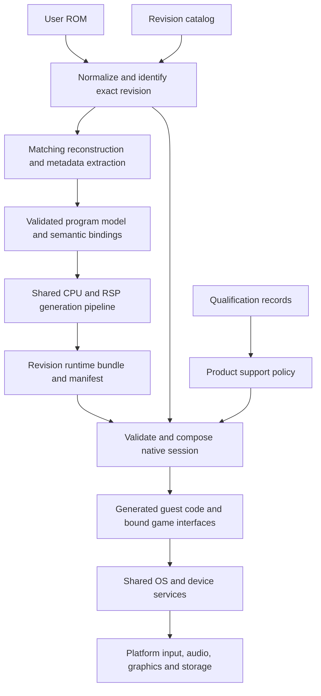

# Architecture plan: US, PAL and Japanese native support

- Date: 2026-11-01.
- Status: common implementation in final build/product qualification under the owner’s five-hour continuation; campaign and release acceptance remain open.
- Source baseline: `54a8b54` on `develop`.
- Scope: the three exact original ROM revisions currently identified as `us`, `pal` and `jpn`.
- Outcome: one maintained architecture that generates, runs, packages and validates all three revisions through the same contracts.

The design makes ROM revision an explicit input to generation and runtime composition.
Shared hardware and host services operate independently of the game revision. Verified bindings
describe each revision's code, data, layouts and required integration points. US must migrate onto
these same interfaces; PAL and Japan must not become side paths around the existing US runtime.

This is the canonical forward architecture plan. The [regional support record](../development/issues/regional-rom-support.md)
owns completed work, failures and evidence. [Current runtime architecture](../development/architecture.md)
describes the implementation that exists today. Proposed paths and types below do not yet exist
unless identified as current files.

## Implementation checkpoint (2026-11-01)

The [regional issue](../development/issues/regional-rom-support.md#five-hour-continuation--current-checkpoint)
owns current source/build identities, exact evidence and historical failures.

| Gate | Implemented or observed | Remaining acceptance |
|---|---|---|
| M0 | Reference inventory, code/data ownership, required record members and common packed schemas reviewed | Final source/build correspondence and owner feature acceptance |
| M1 | Common catalog, typed bindings, immutable bundles and revision-isolated storage | Actual final launcher import/setup/direct-Play handoff |
| M2 | All three final v28 original reconstructions, CPU/audio generation and native builds pass | Final Play/product and owner feature acceptance |
| M3 | US uses the common pipeline; original-reference native differentials and enhanced Goldwood replay pass | Final-build US regression and owner campaign checks |
| M4 | PAL/JP boot, create/reload earlier saves and run enhanced Goldwood replays | Final-build regression and owner regional campaign checks |
| M5 | All-three build admission, launcher routing, exact fractional cadence and shared PAL display units implemented | Final product handoff; live Modern/Floyd/flight/boss/spatial-wipe and other feature matrix |
| M6 | Scoped evidence, failures and compatibility limits retained | Campaign, performance/platform coverage and release review |

v27 native and enhanced Play results apply to its frozen source. v28 includes
later record contracts and build-admission changes; fresh original generation
and native qualification now pass for all three. Final Play/product checks
remain in progress. Build admission permits local
builds; it does not certify every feature or a public release. Earlier v16
original-OS new-slot/reload results are not relabeled as final-build results.

## 1. Starting point and scope

| Foundation at the baseline | US | PAL | Japan / Star Twins |
|---|---|---|---|
| Exact ROM identification | Implemented | Implemented | Implemented |
| Matching original reconstruction | Existing pipeline | Byte-for-byte verified | Byte-for-byte verified |
| Populated executable overlays | 155 | 155 | 155 |
| Recompiler context | Existing generated pipeline | Extracted | Extracted |
| Names found in the bridge’s 69-name SDK candidate list | 58/69 | 0/69 | 41/69 |
| Playable native path | Existing, with documented limitations | Not qualified or run | Not qualified or run |

A missing SDK name means identification is missing. It does not mean the original ROM lacks the
routine. Likewise, exact reconstruction and overlay metadata do not prove complete function
boundaries, generated execution or gameplay correctness.

The current regional contexts have separate entry and main sections, for 157 executable sections
including overlays. The current US transform expects 156. The new model must represent both
layouts explicitly without changing counts merely to admit an input. The full audio microcode
and its companion data match across all three images; task submission, sequencing and timing
still require regional validation.

Initial delivery targets the existing Windows native product and its WSL generation workflow.
Shared contracts remain portable, but Linux live-runtime qualification is a separate open issue.
Additional ROM revisions, modified ROMs, save conversion and a dependency upgrade are separate
deliverables. None is implied by support for these three exact hashes.

## 2. Required design rules

1. **One source of ROM identity.** Python, C++, C#, PowerShell, packaging and diagnostics consume
   the same versioned revision catalog. Filename, language and a manually selected region never
   override the normalized ROM hash.
2. **US uses the same path.** No permanent legacy US dispatcher beside a new regional dispatcher.
   Transitional adapters have an owner, an acceptance test and a removal milestone.
3. **Addresses belong to verified bindings.** Shared game-facing code uses semantic operations
   and typed references. It cannot reach into a default US address table or assume a constant
   address delta across revisions.
4. **Shared hardware behavior has one owner.** CPU/device semantics, clocks, scheduler, memory,
   task completion and storage services are not cloned per region. A regional behavioral adapter
   requires evidence of an actual difference and a focused contract.
5. **Validation remains strict.** Missing required bindings, ambiguous functions, unsupported
   relocations and mismatched artifacts stop generation or startup. No game-function stubs,
   skipped inventory checks, successful no-op device handlers or fallback to another region.
6. **Original regional behavior is preserved.** Compatibility executes the selected game's
   behavior. Optional corrections and enhancements remain individually scoped and qualified.
7. **Identity follows every artifact.** Generated code, runtime, ROM, save namespace and evidence
   must agree on revision and relevant schema/build versions before a session starts.
8. **Support is earned per target.** Metadata readiness, native boot, gameplay qualification and
   released support are separate states. US evidence cannot qualify PAL or Japan.

The existing [execution-profile contract](../adr/0002-execution-profiles.md) remains authoritative.
ROM revision is input identity, independent of behavior profile, execution backend, presentation
backend and feature set. Region must not become a new mode that silently changes those axes.

## 3. Target composition

Use one shared runtime source tree with a separately linked native executable for each revision.
Each executable binds exactly one generated CPU corpus, compatible RSP output and immutable game
descriptor. This avoids collisions between generated symbols and prevents mixing revisions in
one process. A single launcher selects the matching installed bundle. Switching revisions ends
the current session and starts another process.

This is one architecture with three build targets, not three copied runtime implementations.
A universal executable or dynamic game plugin ABI is unnecessary for initial delivery. Common
host libraries and verified tool caches may be shared without sharing revision-specific state.

### Ownership boundaries

| Component | Owns | Must not own |
|---|---|---|
| Revision catalog | Exact input identities, region/title metadata, extraction recipe identifiers | A boolean claiming all gameplay is supported |
| Program-model builder | Sections, functions, aliases, relocations, assets, binding provenance | Host behavior or unverified address guesses |
| Game descriptor and bindings | Revision-specific entry points, field layouts, semantic IDs, capability dependencies | Duplicated device implementations |
| Guest bridge | Invocation ABI, qualified dispatch, hooks and checked game-state access | Independent timing or save engines |
| Shared runtime services | Memory, OS/device behavior, overlay lifecycle, clock and task ownership | Scene-specific offsets or ROM selection |
| Platform services | Window/input/audio devices, renderer integration, files and diagnostics | Guest-memory interpretation by raw game addresses |
| Launcher and package resolver | Import, runtime selection, profile/save namespaces, support status | Inferring compatibility from an executable's filename |
| Qualification records | Evidence for exact revision/build/platform/profile/features | Permission to weaken runtime checks |

Retain the recent native module split. Gradually replace broad access to shared `State` with narrow
service views as hooks move. Keep one simulation-thread owner and one instance of every clock,
scheduler, overlay registry, audio ledger and save store. This migration does not require an
unrelated rewrite of all host services or another wholesale folder reorganization.

## 4. Revision and artifact contracts

### Revision catalog

Introduce `config/roms/revisions.json` with a schema in `schemas/`. It contains stable revision IDs
such as `jfg-us-r0`, `jfg-pal-r0` and `star-twins-jp-r0`, their existing `us`/`pal`/`jpn` aliases,
canonical byte order, exact length/hash, country/revision header checks, title and pinned extraction
recipe. Preserve the known hashes in [ROM profiles](../../scripts/build/rom_profiles.py).

Normalize the three standard dump byte orders into a private copy, then identify the canonical
bytes. Never modify the user's original. An unknown hash remains unsupported even if the header
claims a known country. SHA-1 retains the existing input identity; artifact integrity and build
fingerprints use SHA-256. Add any new canonical digest only after checking the original input.

Generate small language-specific catalog views during the build. The Python profile API becomes
a reader of this catalog; native and launcher constants become generated outputs. PowerShell
delegates identification to the same implementation instead of carrying another hash list.

### Private program manifest and immutable runtime descriptor

| Contract | Required content |
|---|---|
| Input identity | Revision ID, canonical ROM digest/size, source byte order for diagnostics |
| Provenance | Decomp/tool/patch pins, extraction recipe, source/build identity, generator and schema versions |
| Program layout | Static sections, populated and empty overlay slots, text/data/BSS, entry points, validated ROM spans |
| Code inventory | Bodies, aliases, alternate entries, recovered boundaries, direct/indirect call classifications and exceptions |
| Relocation inventory | Source/target section identity, coordinate domains, record units and classified dispositions |
| Game bindings | Semantic operations, guest calling convention, data layouts, hook sites and per-binding evidence |
| Audio/graphics | Microcode identity, extraction recipe, task ABI and required renderer/parser capabilities |
| Runtime requirements | Boot handoff, supported memory configuration, timing policy bindings, save-device and host ABI versions |
| Outputs | Hashes of generated inputs/outputs, binding tables, executable and host dependencies |

The manifest describes observed data. Separately reviewed expectations and invariant checks decide
whether it is valid; generating expected counts from the same output is not independent validation.
Changing an expected inventory requires a recorded reason and review of the affected entries.

Build identity covers the canonical input, dependency pins, schemas, recipes, source closure,
compiler configuration, ABI and generated outputs. Reuse an artifact only when its complete
compatibility key matches. Publish successful bundles atomically; incomplete builds are not
launch candidates. Build resume verifies its manifest and files before reusing them.

Keep the pre-link descriptor separate from the final package manifest. Compute the descriptor
identity from canonical input/model/binding digests, tool/source identities and ABI requirements;
embed that identity in the executable. After linking, the package manifest records executable
and dependency hashes and refers to the descriptor identity. Neither digest includes itself.

A sidecar manifest cannot relabel a US binary as PAL. Startup validates the selected ROM,
embedded descriptor, binding ABI and package before opening writable saves or invoking guest
code. Errors name the incompatible component.

Keep detailed maps, instruction evidence, generated bodies and original inputs private. Public
source contains project-authored contracts, extraction logic, reviewed metadata and synthetic
fixtures, subject to [ROM/data policy](../legal/rom-and-assets-policy.md). This plan does not
authorize publishing private symbol exports or changing distribution policy.

## 5. One regional generation pipeline

Refactor the existing tools into stages with typed inputs and validated outputs:

1. Identify the canonical ROM and select the pinned extraction recipe.
2. Reconstruct the exact image and produce ELF/map metadata in a fresh private workspace.
3. Parse into a revision-independent program model, preserving original section identity.
4. Qualify code boundaries, aliases, SDK/game bindings, relocations and asset boundaries.
5. Lower the validated model into N64Recomp input and generate CPU/RSP code.
6. Compile the shared runtime with that revision's generated descriptor and dispatch tables.
7. Verify output identity and emit the bundle manifest plus a separate validation receipt.

Reuse [regional reconstruction](../../scripts/build/prepare_regional_metadata.py) and
[overlay parsing](../../scripts/build/regional_overlays.py) inside these stages. Make
`generate_from_rom.py`, `build_from_rom.py`, the private build tooling and metadata-only command
call the same services. Metadata-only preparation stops after its declared stage; it cannot
set native admission. Existing CLI wrappers remain thin compatibility entry points.

Replace US filenames, symbol assumptions and hardcoded inventory constants in
[the transformer](../../scripts/build/transform_private_n64recomp_inputs.py) with validated
program-model inputs and per-revision expectations. Preserve current US checks while migrating
their ownership. Port SDK helper recovery and [timing instrumentation](../../scripts/build/original_timing_generation.py)
to qualified semantic sites, including a review of `phase9_recover_task_helper.py`.

### Section and call identity

Represent a code location as `(revision, section, offset)`, with an explicit section kind and
mapping to its original ROM/linked coordinates. A static entry section is a valid section, not
a forced alias of main. A runtime overlay handle additionally includes the active load generation.
Raw VRAM alone is not an identity when sections overlap or are reloaded. Logical module names
map to slots per revision; equal slot numbers do not prove equal cross-region meaning.

Keep source patch location and relocation target domain explicit: text-relative, data-relative,
linked address and overlay offset cannot be interchanged. Validate byte lengths, alignment,
signed addends, HI16/LO16 pairing, bounds, dependencies and reserved/exceptional entries. Preserve
the loader's staged commit and stale-token rejection. Cover cold load, unload, reload and the
original suspend/resume behavior without duplicating a lifecycle already performed by guest code.

Identify every required body and classify every call/alias. Anonymous functions can retain stable
section-qualified identities; a friendly name is required only where a semantic binding needs it.
All required boot-bridge routines must have qualified identities and ABI contracts. If an operation
is deliberately delegated to generated guest code, record and test that execution disposition.
Never substitute an empty success handler for an unidentified routine.

## 6. Typed game bindings and hook ownership

Introduce a generated, immutable `GameDescriptor` assembled from verified revision metadata.
It supplies interfaces conceptually named `BootBindings`, `OsBindings`, `OverlayBindings`,
`GameStateLayout`, `SceneBindings` and `TaskBindings`. These names describe responsibilities;
avoid turning them into one untyped dictionary of every address.

- A `FunctionRef` identifies section/offset, signature, calling convention, return behavior and
  permitted invocation point. Resolve it only against the current section/load generation.
- A `DataRef` declares section/offset or a validated pointer path, extent, alignment and access.
  Field descriptors define guest widths, endianness, strides and bounds. Do not cast guest bytes
  to a host structure or assume US actor/control structures match PAL/JP.
- A semantic operation such as reading the current scene or submitting controller results binds
  once at session composition. Shared code does not perform string lookup or scan signatures on
  every guest call. Generated tables and direct accessors keep dispatch costs bounded.
- Each recovered binding records how it was identified and validated. Instruction patterns may
  aid offline discovery, but ambiguous matches cannot enable an unattended runtime hook.

Split `guest_execution.cpp` by responsibility as bindings are introduced: generated dispatch,
OS/device bridge, game observation/access, and feature hooks. Give hooks stable IDs, invocation
phase, dependency set, allowed state effects, ABI version and region-specific qualification.
Classify every existing hook as required integration, optional enhancement, diagnostic observation
or obsolete workaround. Remove a workaround only after its replacement has evidence.

Hardware constants such as MMIO register addresses remain in shared hardware code. Game function
addresses, globals, structure offsets, scene/asset identifiers and code-signature guards move to
their binding owners. This includes input/camera helpers, navigation, cutscene controls, renderer
enhancements, diagnostic readers and replay tools outside `guest_execution.cpp`.

Mandatory binding failure prevents startup. An unavailable optional feature is explicitly shown
as unavailable and stays disabled; its game-memory hooks never install. Full feature support
requires closing those gaps, rather than treating permanent disabling as completed regional work.
Evidence-backed regional adapters may express genuine control-flow or ABI differences. Three
near-identical copies of a handler, region switches throughout shared code, or a global address
translation delta do not satisfy the design.

## 7. Boot, timing, graphics, audio and original behavior

Boot handoff consumes a validated boot profile, including TV mode, reset/memory configuration,
entry state and actual CIC requirements. The current `rom_image.cpp` explicitly initializes a US
TV mode; that decision moves to the profile. Do not infer a different CIC solely from the region.

Keep guest simulation/device timing, guest VI configuration and host presentation rate separate.
PAL's nominal 50 Hz environment and US/JP's nominal 60 Hz environment are starting categories;
actual periods and behavior come from validated clock/VI configuration. Represent rates and
accumulated deadlines precisely rather than rounding each frame to milliseconds. Qualify mode
changes, interlacing, input sampling, timer ordering, DMA/task completion and audio sample rates.
Selecting 120/240 FPS presentation must not multiply guest updates, input polls or save activity.

The existing production host-clock policy and diagnostic original-OS clock have different
qualification limits. Preserve and name them in receipts. Moving their inputs into profiles does
not resolve [original-mode simulation parity](../development/issues/original-mode-simulation-parity.md)
or reopen the shelved timing investigation. No arbitrary regional pacing correction may stand in
for an identified timing cause.

Reuse audio microcode generation only when the program, companion data and ABI match. Qualify
each region's source locations, command submission, callbacks, queues, sequence/bank assets and
sample accounting. Test loading and transition audio as well as steady gameplay. Keep graphics
command semantics and completion ownership shared; qualify regional task streams, framebuffer
readback, VI dimensions, camera/interpolation hooks and menu/text rendering.

Preserve [known regional behavior](../original-game/regional-differences.md): Walkway departure
has no music in the owner's US hardware check and has music in the PAL EmuHawk check. PAL hardware
and Japanese behavior remain unknown. The architecture must allow original assets and code to
produce the regional result without inserting a universal music override. Preserve native bugs
in compatibility behavior; any optional correction needs its own evidence and feature policy.

Language is separate from ROM identity and TV mode. Retain each ROM's available language behavior,
fonts, text layout and title/menu assets. Qualify Japanese text both in game rendering and any host
UI that exposes guest strings. Do not replace the Japanese assets with US assets or assume a host
locale selects the game's revision.

## 8. Launcher, storage and product support

The launcher imports a ROM, identifies it, and selects a compatible runtime bundle. Display the
detected title/revision and actionable support status. A region selector may choose among already
identified installations; it cannot override a mismatched ROM. Direct command-line Play goes
through the same resolver and runtime checks. Diagnostics include revision, build and feature
identity using the existing filtered support-export boundary.

Use separate namespaces for immutable build artifacts, user preferences, game saves and runtime
checkpoints. Proposed save ownership is `<profile>/saves/<revision-id>/`; build caches include a
build fingerprint, while ordinary saves do not move for every rebuild. Share controller/display
preferences where appropriate. Bind checkpoints/replays to the exact revision, build and state
schema, and reject incompatible resumes.

Migrate an existing untagged US profile transactionally: preserve a backup, record the migration,
retain the original until success, and make retries safe. Never assign an ambiguous old save to
PAL/JP by guesswork. Switching ROMs cannot silently overwrite another region's saves. Default to
separate FlashRAM and Controller Pak persistence until format compatibility is independently
established. Cross-region import/conversion is a separate, explicit operation with validation.

Save acceptance covers valid game slots and checksums as well as device persistence: new game,
write/reload, character/progression state, corruption recovery, interruption, reset and storage
failures. The one successful copied PAL save in EmuHawk is not a compatibility specification.

Maintain evidence-backed support states per revision, platform and feature/profile combination:
`recognized`, `metadata-verified`, `generation-verified`, `boot-verified`, `gameplay-qualified`,
and `released`. Product admission consumes reviewed qualification records. A successful local
build may be a developer candidate without becoming an ordinary supported Play target. Expose
only features qualified for that target, and retain a visible list of remaining feature gaps.

Packaging binds the launcher catalog, executable/descriptor and required host libraries. Verify
clean install, upgrade, removal, direct launch and side-by-side regional installations. Continue
the existing owner-ROM and reviewed-prebuilt distribution rules; a three-region package is a
separate release decision, not a consequence of writing this plan.

## 9. Intended file ownership

These are target homes, not a request to create empty scaffolding or move unrelated files.

| Target | Responsibility and current migration source |
|---|---|
| `config/roms/revisions.json`, `schemas/rom-*.schema.json` | Canonical catalog and versioned input/program/bundle contracts |
| `scripts/build/rom_profiles.py` | Stable catalog/normalization API; remove duplicated hash lists in consumers |
| `scripts/build/regional/` | Shared extraction, program model, binding qualification and generation stages; consolidate current regional helpers and US-only recipes here as consumed |
| `include/jfg/game/`, `src/game/` | Typed game contracts and shared semantic access; no ROM-derived bodies or private symbol dumps |
| Private generated bundle directory | Per-revision code, bindings, layouts, detailed evidence and manifests; outside tracked source |
| `src/boot/native/` | Session composition, native bridge and existing host module owners; shrink coupled guest dispatch incrementally |
| `src/runtime/`, `src/boot/`, `src/renderer/` | Existing shared device, scheduler, overlay and renderer implementations; retain their ownership |
| `cmake/GeneratedCode.cmake`, `cmake/NativeTargets.cmake` | Parameterized revision targets, ABI checks and shared host linkage |
| `launcher/native/`, `launcher/windows/`, `launcher/ui/` | Existing frontend owners consume catalog/resolver results and feature support |
| `scripts/release/` | Regional package manifests, identity checks and source/data hygiene |
| `tests/build/`, `tests/runtime/`, launcher tests | Synthetic schema, identity, binding, lifecycle, storage and UI contract coverage |
| `docs/development/issues/regional-rom-support.md` | Canonical implementation/evidence status; link this plan rather than duplicate it |

Keep published entry points and established `scripts.<tool>` imports working during migration.
Delete superseded implementations once all consumers and evidence producers use the new owner.
Follow the [repository retention policy](../development/repository-layout.md); update the file audit
and source fingerprint inventories as ownership changes.

## 10. Implementation sequence and exit gates

Each milestone produces reviewable source and an evidence receipt. Build success alone cannot
close a runtime milestone. Preserve a working US candidate until its replacement passes the
required gates; rollback selects a previous complete bundle and never mixes old/new components.

### M0: inventory and baseline contract

- Inventory all ROM hashes, US filenames, absolute game addresses, field offsets, scene IDs,
  generated ABI assumptions, timing sites and save-path decisions across source and tools.
- Classify every integration point using the hook categories in section 6. Record its current
  owner, all consumers, revision dependencies, intended replacement and required validation.
- Preserve current source/build identities and representative private US replay/save baselines.
  Record existing failures and unqualified behavior separately from migration regressions.
- Define the release feature matrix for all three revisions, including baseline controls,
  modern controls, camera/presentation features, navigation and cutscene tools where advertised.

**Exit:** a reviewed migration inventory with no unassigned required integration point, an exact
baseline and a test matrix. No current fix is silently lost because it was buried in a dispatcher.

### M1: catalog, schemas and session identity

- Implement the single revision catalog and generated consumer views.
- Specify the private program model, binding ABI, bundle manifest and qualification record;
  record accepted architectural decisions in a new ADR without editing frozen contracts.
- Implement ROM/descriptor/bundle checks, revision-keyed workspace selection and support-state
  handling. Regional metadata remains usable without implying gameplay admission.
- Model all three revisions now, including PAL/JP's separate entry section and unresolved fields.

**Exit:** synthetic tests reject unknown revisions, catalog drift, mixed binaries/manifests,
wrong ABIs and incomplete bundles before guest execution or writable storage. Existing US import
still works; catalog recognition alone cannot enable PAL/JP Play.

### M2: complete and qualify each program model

- Consolidate extraction and section/relocation parsing into the shared stages.
- Qualify US mappings and recover missing PAL/JP SDK and game bindings. Resolve function boundaries,
  aliases, helper recovery, asset bounds and direct/indirect-call inventories independently.
- Validate PAL's unqualified asset-table extent and all revision-specific static layout decisions.
- Establish reviewed expectations and private evidence for every mandatory binding, including
  boot/task integration; retain failures and unresolved entries explicitly.

**Exit:** each revision has an exact reconstruction and a complete validated model sufficient for
generation. Every required binding has a supported execution disposition. Changing a dependency
pin, if later justified, requires a separate pin decision and regenerated evidence for all targets.

### M3: migrate generation and US execution to shared interfaces

- Produce US CPU/RSP inputs from the new model and preserve independently checked coverage.
- Migrate guest dispatch, OS bindings, game-state access and feature hooks incrementally onto the
  descriptor. Parameterize CMake and update native source/evidence fingerprint closures.
- Keep hardware behavior and task/clock ownership unchanged during each extraction. Replace
  transitional adapters one responsibility at a time after their tests and scoped replays pass.
- Exercise PAL/JP-shaped synthetic layouts at every shared interface to expose hidden US defaults.

**Exit:** a fresh US build runs through the shared architecture; agreed US gameplay/save/audio
regressions pass. No required game address bypasses its binding owner. All baseline inventory
dispositions are reconciled, and the executable does not depend on a parallel legacy US dispatcher.

### M4: native PAL and Japanese integration

- Generate and link each regional target through the same pipeline.
- Qualify regional boot/OS handoff, overlays, task paths, controller and save behavior.
- Validate PAL timing/VI configuration and Japanese title/text/menu assets. Port every required
  game-state and feature binding with explicit availability while qualification is incomplete.
- Run native title-to-gameplay, save/reload and normal/skipped transition acceptance for both.
  Maintain US regression coverage for every shared behavior change.

**Exit:** separate private native boot and gameplay-slice receipts for all three revisions, with
no unclassified required operation or mixed-region fallback. This is a candidate milestone;
campaign and feature qualification remain open.

### M5: product integration and complete feature coverage

- Finish launcher/direct-launch routing, save migration/isolation, bundle discovery, resume and
  packaging. Exercise failed/interrupted import/build/migration and recovery paths.
- Complete each cell of the agreed three-revision feature matrix. Every disabled feature remains
  open work unless evidence establishes that it genuinely does not apply to that revision.
- Remove duplicated validators, temporary US adapters and superseded regional tooling. Update
  developer/player documentation and support exports without rewriting historical evidence.

**Exit:** clean installation and upgrade work for each target, side-by-side installations remain
isolated, and every advertised feature has revision-specific evidence. No alternate launcher
path can bypass identity, feature or save checks.

### M6: campaign qualification and release readiness

- Complete the route/character/feature acceptance matrix below for each revision.
- Review performance, crash/hang behavior, save durability and compatibility with the supported
  host configurations. Re-test affected regions after any shared change.
- Publish only filtered receipts and reviewed package contents. Record actual release/commit
  identity after the normal release process; maintain candidate and release status separately.

**Exit:** all three meet the declared regional support scope, remaining shared limitations are
explicit, and a reviewed package is ready for release. The plan is not complete merely because
PAL and JP boot or because optional features can be disabled.

The dependency order is M0 -> M1 -> M2 -> M3 -> M4 -> M5 -> M6. Small interface extractions may
overlap preparation, but each gate requires its inputs. Scope a failed gate to a concrete cause
and evidence requirement rather than relaxing the contract to advance to the next milestone.

## 11. Validation strategy

### Public, ROM-free contract checks

- Catalog consumers agree; all three byte orders normalize consistently; modified, truncated,
  wrong-header and unknown-revision inputs fail appropriately.
- Synthetic programs cover separate/combined entry layouts, overlapping overlay coordinates,
  aliases, alternate entries, missing/ambiguous bindings, relocation domains and stale handles.
- Descriptor and build identity tests reject unqualified cross-region code/task-metadata/manifest
  combinations, stale cache entries, unsupported ABI versions and partial outputs. Shared RSP
  output requires matching program/data/ABI identity and qualified regional task bindings.
  Equivalent input byte orders produce the same canonical ROM identity.
- Device/storage tests exercise transactional failure and corruption. Include the catalog's
  FlashRAM sector-erase question with distinct neighboring sectors; do not assume it is already
  resolved by successful save/reload.
- Runtime tests prove optional hook rejection, single clock/task ownership and expected event
  ordering without installing guessed game addresses. Test the existing deterministic/headless
  contracts within their documented scope; no mock pass becomes gameplay acceptance.
- Launcher tests cover detected-revision presentation, unsupported targets, failed migration,
  direct launch and shared preferences with isolated persistence.

### Private generation and runtime qualification

| Area | Required evidence for each revision |
|---|---|
| Fresh generation | Exact original reconstruction; independently checked code/call/relocation inventory; no game-function stubs; native compile/link and output manifests |
| Boot and frontend | Cold boot/reset, title/menu flow, language/text correctness, character selection and repeat launch |
| Controls/accessories | Keyboard/controller paths, all supported controller ports, connection changes, rumble and supported multiplayer/co-op behavior |
| Saves | New/existing slots, all characters, progression, restart/reload, invalid data, storage failure and region isolation |
| Timing/presentation | Original VI modes, declared timing policies and supported output rates; sustained gameplay, input/audio synchronization and mode transitions |
| Graphics/audio | Representative microcode/task paths, readback, effects, UI/text, music/sound and loading/transition behavior |
| Overlays/transitions | Distinct overlay groups, dependencies, repeated load/unload and verified suspend/resume semantics |
| Campaign | Each playable character, worlds and major progression routes, bosses, collection requirements, final sequence and credits |
| Cinematics | Normal and skipped entry/exit routes, including Walkway and the separately unverified Vela routes |
| Enhancements | Each advertised feature and meaningful interacting combinations; compatibility remains available |
| Product | Clean install/upgrade, build resume, side-by-side versions, direct launch, support export and clean exit |

Use the same scenario definitions expressed through semantic bindings, but compare each revision
against its own original-game reference. Cross-region RAM equality, identical frame counts and
identical music are not valid universal expectations. Bind a replay to its ROM, build, state
schema, inputs, settings, route and capture producer. Classify reference evidence as native
hardware, original-ROM emulator or native recomp; never promote one category to another.

Record original behavior before defining a regression expectation where regional behavior is
unknown. Prioritize PAL timing/music and Japanese text/progression observations. Hardware evidence
is required for a hardware-parity claim; emulator comparison can support only its recorded scope.
Inherited US limitations, including timing parity, remain visible in all affected target records.
Regional feature completion does not itself establish full original-console parity.

Counts must name their units: bodies, aliases, call sites, relocation records, scenarios and
feature combinations are different measures. Aggregate test totals and successful code generation
cannot replace the acceptance matrix or yield a meaningful overall completion percentage.

## 12. Completion checklist and execution constraints

- [x] One catalog supplies every build/runtime/launcher consumer.
- [x] All three exact revisions pass the shared model and generation contracts.
- [ ] US runs entirely through the same architecture as PAL and Japan.
- [ ] Required hooks use qualified typed bindings; unknown or mismatched bindings fail closed.
- [ ] Shared device, scheduler, timing and task-completion ownership remains singular.
- [ ] PAL timing, Japanese assets/text and original regional behavior have scoped evidence.
- [ ] Launcher, direct launch, packages, save isolation and upgrade/migration pass for all three.
- [ ] Every advertised feature has completed regional qualification or documented non-applicability.
- [ ] Campaign/transition acceptance and US regressions pass within the declared product scope.
- [ ] Temporary adapters and redundant implementations are removed; docs and evidence identify
      actual candidate/release status and remaining limits.

Consult the [pinned upstream review](../upstream/reference-review-2026-10-01.md) and
[reference catalog](../upstream/reference-catalog.json) during implementation. In particular,
JFG-UP-012/013/027 concern relocation coordinates and symbol provenance; JFG-UP-009/014-018 concern
overlay lifecycle; JFG-UP-020-023 concern saves/controller semantics; JFG-UP-024 concerns audio
scheduling. They are observations and pending validation work, not permission to copy code,
change dependency pins or assume the cited behavior has been qualified locally.

Implementation is currently executing under the owner's eight-hour approval, four-hour continuation
and five-hour continuation
in the same guarded investigation. The initial ledger observation below is
historical. Shared generation, typed resident bindings/memory, original module
ownership, device clocks/FlashRAM, regional bundles and launcher resolution are
implemented candidates; the issue record distinguishes passed tests, preserved
build failures and pending live gates. None of the unchecked acceptance items
is implied complete by these candidates.

This document does not start or reopen an investigation. The production guard was checked read-only
on 2026-11-01: enabled; existing investigation `high-refresh-rendering-20261011` shelved with
123/123 attempts and 101/101 activity used. The authoritative ledger remains
`D:/JFG-private/autonomy-production/jobs.sqlite`; re-read it before any future execution rather
than treating this snapshot as current admission. Under [AGENTS.md](../../AGENTS.md) and the
[guard contract](autonomy-progress-guard.md), implementation, builds and replays must use admitted
supervisor jobs. Do not rename/re-root this work, reset counters or execute directly after denial.

Keep new bugs, regressions and significant limitations in persistent issue records as work
proceeds, including hypotheses, failed remedies, actual cause, validation and remaining limits.
Preserve existing user data, private evidence and immutable historical contracts. These guard
and issue-record requirements must survive every compaction, restart and handoff.
